# 2026 U.S. Election Results, 20-Year Historical Shift (2004–2026), Demographics & Moneyball Explorer

> ### **[Launch Live Interactive Dashboard → `https://mike10010100.github.io/elections-2026/`](https://mike10010100.github.io/elections-2026/)**

Live interactive election results explorer, county-by-county **2004 → 2026** shift arrow map, **U.S. Census ACS county demographic coalition analyzer**, **FEC Campaign Finance ("Moneyball")** dataset, and **Democratic faction / breaking-points comparative analysis**, powered by **15-minute automated cron pulls (`*/15 * * * *`)** from **civicAPI** (39,578 federal, state, and local races), **NYT 2024/2026 county-level & per-district returns** (3,152 counties/equivalents + all 435 U.S. House district county feeds), **MIT/Heideman & FiveThirtyEight 2004–2024 historical archives**, and **FEC 2026 bulk campaign finance + independent expenditure disclosures**.

---

## Live Dashboard Views & Features (`index.html` / `app.js`)

* **9 Context-Aware Top-Level Tabs:**
  * **U.S. Senate (35 seats)**, **U.S. House (435 seats)**, & **Governors (36 seats):** Live chamber Balance of Power bars, 2026 → 2004–2024 county shift arrow map, By-Winner state/county choropleth, and Uncounted-Vote bubble forecast map.
  * **Demographics & 20-Yr History (2004–2026):** Apples-to-apples comparisons across 22 years of Presidential, Senate, and House cycles (`p24..p04`, `s26..s04`, `h26..h04`, `g26`, `ag26`, `top26`) broken down by U.S. Census county Urbanicity, College Education, Household Income, and Race/Ethnicity.
  * **Too Close to Call:** Isolates uncalled and razor-thin ($\le 2\%$) federal and gubernatorial races on the map and card explorer.
  * **Analysis & Moneyball (`FEC · RCV · Cohorts`):**
    1. **Mississippi Plurality Law (`Miss. Code Ann. § 23-15-605`) & Late-Ballot Tracker** + **Alaska RCV & Same-Name Spoiler Breakdown**
    2. **Interactive FEC Moneyball Explorer** (sortable/searchable Senate & House Candidate + Super PAC IE spend, counter-spend, and `$/pt` of shift)
    3. **Ideological Factions & 5-State Same-Ballot Natural Experiments** (`MI, MN, ME, NM, FL` — `276 of 286 counties`)
    4. **Disjoint Breaking Points & Cross-Ballot Contagion** (`3,143 counties`, demographic vs. cross-ballot PCA)
    5. **Live-Regenerated Research Charts Gallery (Charts 1–13)**
  * **Ballot Measures (169 statewide measures)** & **State Legislatures (90 chambers)**
  * **All 39,578 Races:** Searchable/filterable explorer across every federal, state, county, municipal, judicial, and school-board contest on the 2026 ballot.
* **Smart Map Context & Data Hygiene:** Greys out irrelevant/off-cycle states with a diagonal hatch pattern and explanatory legend/tooltips on every view; hydrates per-district U.S. House county reporting units and within-district 2024 Presidential baselines; enforces strict deduplication for concurrent regular+special Senate races, ME/NE Congressional Districts, RCV Round 1 normalization, and NY/CT fusion ballot lines.

---

## Live-Updating Comparative Faction, Breaking-Points & Moneyball Charts (`assets/`)

Every 15 minutes, when new election returns arrive, [`fetch_results.py`](fetch_results.py) rebuilds the site datasets and invokes [`build_fec_moneyball.py`](build_fec_moneyball.py), [`build_breaking_points.py`](build_breaking_points.py), [`build_analysis_charts.py`](build_analysis_charts.py), [`build_rhetoric_vs_record.py`](build_rhetoric_vs_record.py), [`build_texas_split_ticket.py`](build_texas_split_ticket.py), [`build_texas_housing_edpol.py`](build_texas_housing_edpol.py), [`build_talarico_record_verification.py`](build_talarico_record_verification.py), and [`build_bonica_grumbach_panel_test.py`](build_bonica_grumbach_panel_test.py) to regenerate the open-source datasets and all 13 charts below:

### 1. U.S. House Caucus Performance & The `DSA (n=7)` Carveout
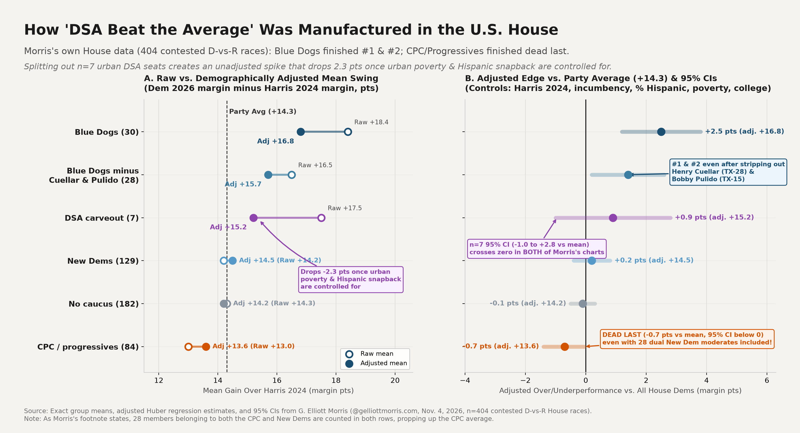

### 2. U.S. Senate: `0-for-6` Progressive Record & Non-Linear GAM vs. Linear Slope
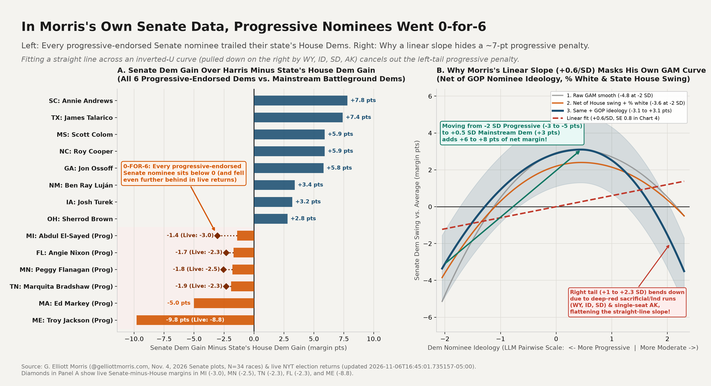

### 3. Same-Ballot Statewide Natural Experiment (`MI, MN, ME, NM, FL` — `276 of 286 Counties`)
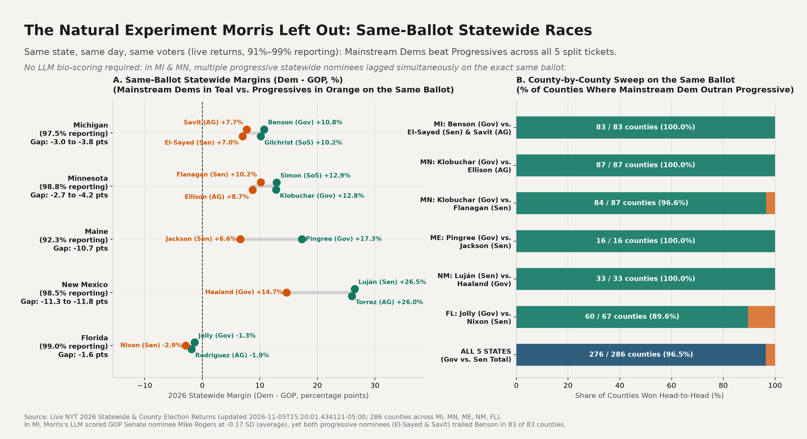

### 4. Disjoint Breaking Points: 2018 Midterm vs. 2026 Midterm Shifts Across 8 County Cohorts
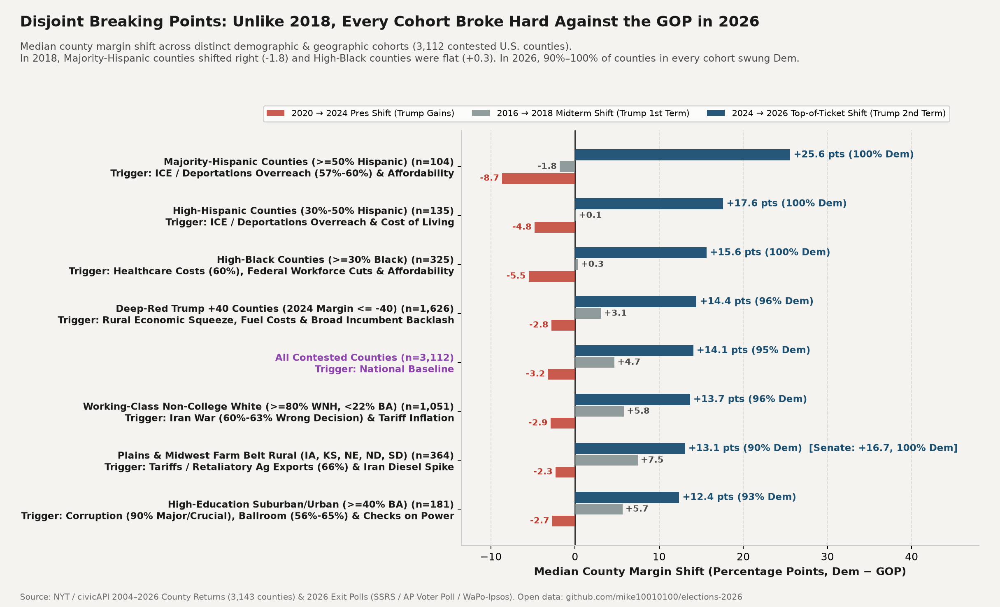

### 5. The 60% Disapproval Convergence Ceiling Across Issue Breaking Points
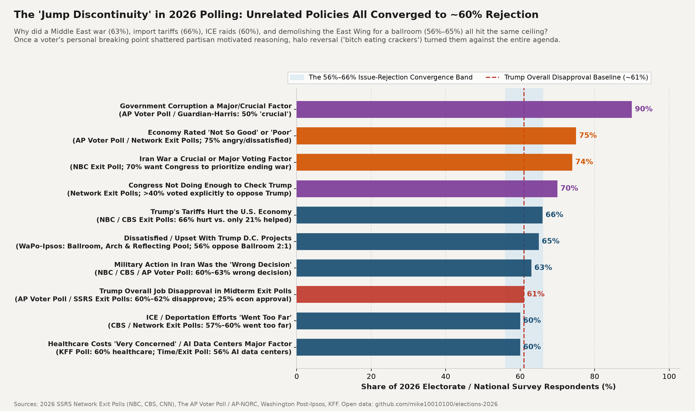

### 6. Down-Ballot Contagion: U.S. Senate vs. State Attorney General County Shift (`r = 0.86`)
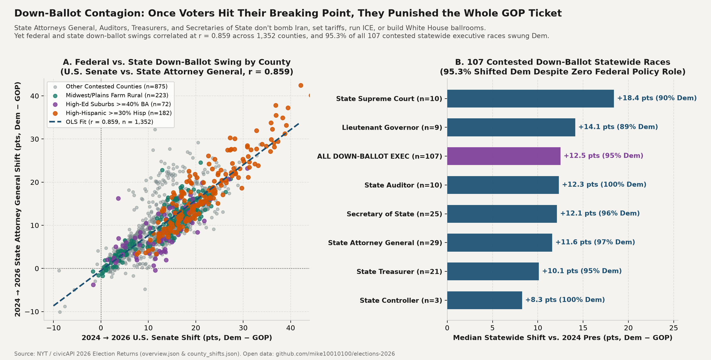

### 7. 2026 Senate 'Moneyball': Diminishing Returns & Endogenous GOP Counterspend
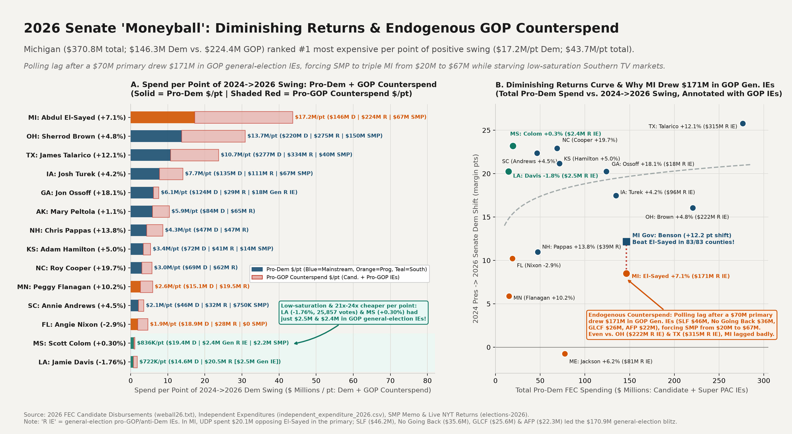

### 8. Rhetoric vs. Record in 2026: Blinded LLM Campaign/Interview Rhetoric vs. Past Record (`N=49`)
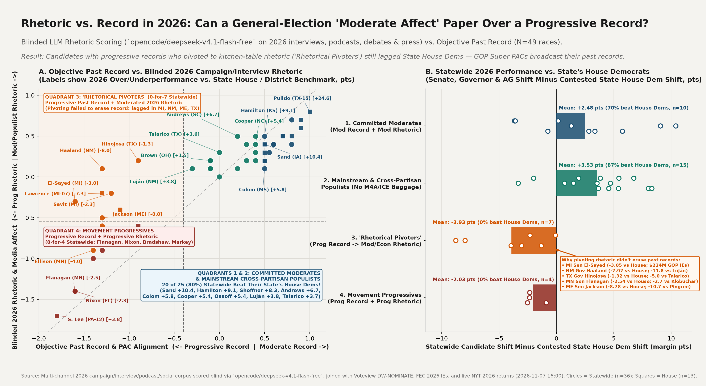

### 9. Anatomy of a 490,000-Vote Split Ticket: Talarico (+12.1%) vs. Hinojosa (+7.1%) in Texas (`254 Counties`)
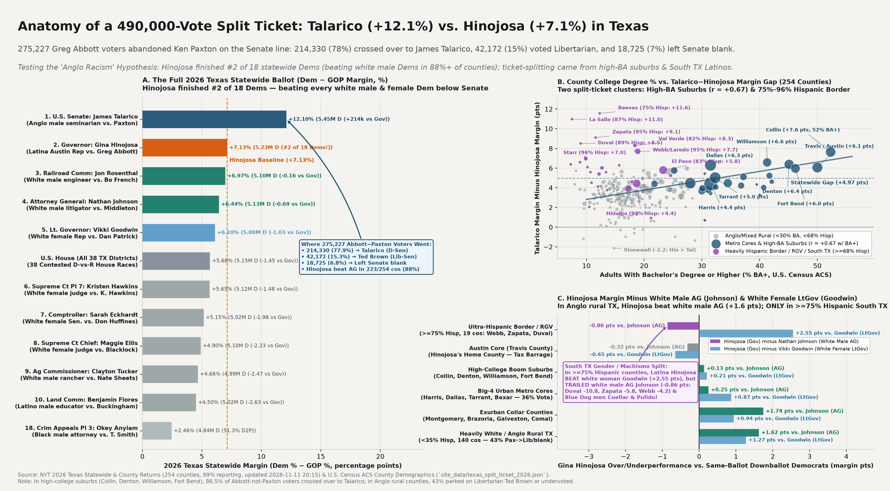

### 10. How YIMBY Texas Built Its Own Blue Wall: Housing Permits (`2010–2024`) × Educational Polarization (`2000–2026`)
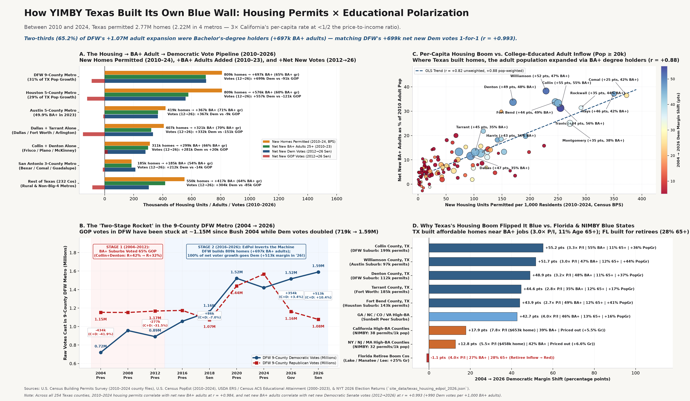

### 11. Texas Legislature Empirical Roll-Call Audit (`2019–2025`): Talarico (`#29/62` Caucus Median) vs. Hinojosa (`#1–#8`) & Crockett (`#3/67`)
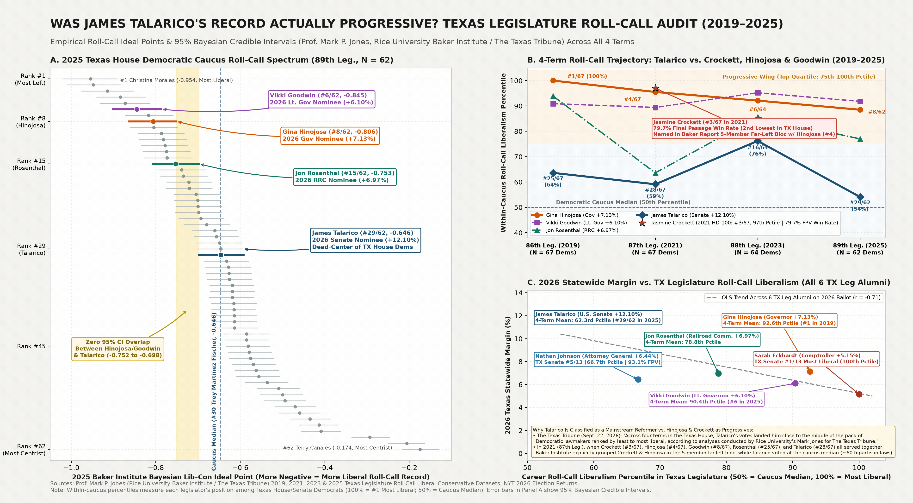

### 12. Bonica-Grumbach & Wertheimer-Caley Panel Test: Within-Texas TWFE (`2006–2026`), Within-District Baselines & Base Turnout
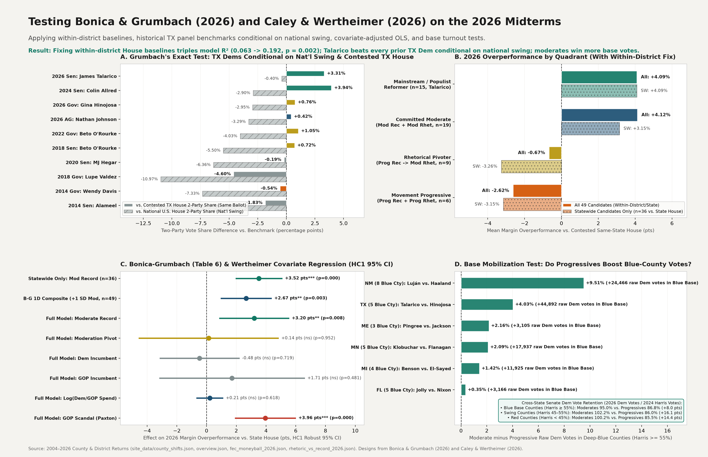

### 13. Economic vs. Cultural Moderation in 2026: 2D Record × Cultural/Populist Archetypes (`N=49`)
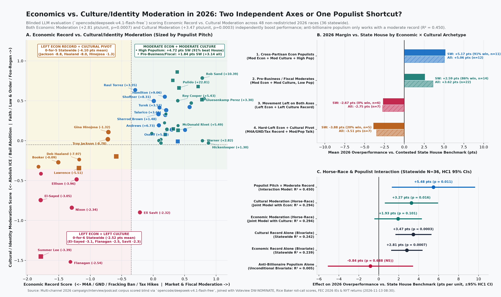

---

## Open-Source Data Files (`site_data/`)

All processed JSON and CSV datasets are committed directly to [`site_data/`](site_data/) and updated automatically whenever live vote counts change:

* **[`site_data/overview.json`](site_data/overview.json):** Full national & state-by-state summary of 2026 U.S. Senate (35 seats), U.S. House (435 seats), Governors (36 seats), 139 Statewide Executive races (AG, SoS, Auditor, Treasurer), 90 State Legislative chambers, and 169 Ballot Measures, joined with 2004–2024 Presidential (including within-district 2024 Presidential baselines for all 435 U.S. House seats) and same-office baselines.
* **[`site_data/county_shifts.json`](site_data/county_shifts.json):** County-by-county 2004–2026 vote margins, two-party shifts, and U.S. Census ACS demographics across 3,143–3,152 counties/equivalents (`s26`, `g26`, `h26`, `ag26`, `top26`, `p24..p04`, `s24..s04`, `h24..h04`).
* **[`site_data/states/*.json`](site_data/states):** Per-state full race breakdowns across all 39,578 federal, state, and local contests.
* **[`site_data/faction_analysis_2026.json`](site_data/faction_analysis_2026.json):** Live-computed House caucus benchmark comparisons, Senate-minus-State-House shifts, same-ballot statewide executive comparisons (`MI, MN, ME, NM, FL`), and county head-to-head tallies (`276/286 counties`).
* **[`site_data/rhetoric_vs_record_2026.json`](site_data/rhetoric_vs_record_2026.json) / [`rhetoric_vs_record_2026.csv`](site_data/rhetoric_vs_record_2026.csv):** Multi-channel 2026 candidate campaign, interview, podcast, debate, and social rhetoric corpus scored blind via `opencode/deepseek-v4.1-flash-free` (`N=49` Senate, Governor, AG, and competitive House candidates), joined with Voteview DW-NOMINATE roll-call records, economic vs. cultural moderation decompositions, FEC ideological PAC IEs, and live 2026 vote returns.
* **[`site_data/texas_split_ticket_2026.json`](site_data/texas_split_ticket_2026.json):** Complete 18-race Texas 2026 statewide ballot comparison and 254-county ticket-splitting decomposition between U.S. Senate (`James Talarico +12.10%` vs. `Ken Paxton`), Governor (`Gina Hinojosa +7.13%` vs. `Greg Abbott`), Attorney General (`Nathan Johnson +6.44%`), and Lt. Governor (`Vikki Goodwin +6.10%`), joined with U.S. Census ACS county demographics (`% BA+`, `% Hispanic`, `% White`, `% Black`, median income) and regional cohort summaries.
* **[`site_data/texas_housing_edpol_2026.json`](site_data/texas_housing_edpol_2026.json):** 254-county and regional Texas dataset joining U.S. Census Building Permits Survey (`2010–2024` single-family and multi-family units permitted), U.S. Census Population Estimates & Migration Components (`2010–2024`), USDA ERS / Census Educational Attainment (`2000`, `2008–12`, `2019–23` raw counts and shares of `BA+` vs. `Non-BA` adults 25+), and `2004–2026` election vote shifts (`r = +0.993` between net new `BA+` adults and net new Democratic votes).
* **[`site_data/texas_legislative_ideology_2019_2025.json`](site_data/texas_legislative_ideology_2019_2025.json):** Four-term (`2019`, `2021`, `2023`, `2025`) Rice University Baker Institute / *The Texas Tribune* Poole-Rosenthal Bayesian roll-call ideal points and 95% credible intervals for the Texas Legislature (Prof. Mark P. Jones), comparing 2026 statewide nominees James Talarico (`#29/62` in 2025, `62.3rd` pctile 4-term mean), Gina Hinojosa (`#1/67` in 2019, `#8/62` in 2025, `92.6th` pctile mean), Vikki Goodwin (`#6/62` in 2025, `90.4th` pctile mean), Jon Rosenthal (`#15/62` in 2025, `78.8th` pctile mean), Nathan Johnson (`#5/13` TX Senate), Sarah Eckhardt (`#1/13` TX Senate), and Jasmine Crockett (`#3/67` in 2021, `79.73%` Final Passage win rate).
* **[`site_data/bonica_grumbach_methodology_test_2026.json`](site_data/bonica_grumbach_methodology_test_2026.json):** Empirical evaluation of Bonica & Grumbach (2025, 2026) and Wertheimer & Caley (2026) panel designs across Within-Texas historical statewide & 254-county TWFE panels (`2006–2026`), exact within-district 2024 Presidential House baselines (`N=49`), multivariate regression controlling for incumbency, spending, and scandal, and partisan base-turnout mobilization tests across 22 Senate states (`1,640` counties).
* **[`site_data/fec_moneyball_2026.json`](site_data/fec_moneyball_2026.json) / [`fec_moneyball_senate_2026.csv`](site_data/fec_moneyball_senate_2026.csv) / [`fec_moneyball_house_2026.csv`](site_data/fec_moneyball_house_2026.csv):** Complete 2026 FEC candidate disbursements + Super PAC / Independent Expenditures (`support Dem + oppose GOP` vs. `support GOP + oppose Dem` counter-spend) joined with 2026 vote shifts and marginal cost per shifted vote/point.
* **[`site_data/breaking_points_2026.json`](site_data/breaking_points_2026.json) & [`site_data/exit_polls_2026.json`](site_data/exit_polls_2026.json):** 2026 Exit Poll / AP Voter Poll / WaPo-Ipsos issue disapproval compilation joined with live 3,143-county disjoint-cohort shift comparisons (`2016→2018` vs. `2020→2024` vs. `2024→2026`), data-center corridor residual analysis, demographic & cross-ballot PCA decompositions, and federal-to-state down-ballot contagion metrics.

---

## Pipeline Scripts

* [`fetch_results.py`](fetch_results.py): Runs every 15 minutes via cron (`*/15 * * * *`), pulls the latest 39,578-race dataset from `civicapi.org` and NYT 2026 county & per-district feeds, deduplicates unchanged snapshots, rebuilds `site_data/` and `assets/chart1..chart13.png`, and auto-commits/pushes to GitHub only when actual vote counts or race calls change.
* [`fetch_2024_and_2026_nyt.py`](fetch_2024_and_2026_nyt.py): Atomically downloads 2024-11-05 and 2026-11-03 national, 50-state+DC, and all 435 per-district U.S. House county JSON feeds (caching per-district responses by `updated_at`).
* [`build_site_data.py`](build_site_data.py): Compiles and normalizes `site_data/overview.json`, `site_data/county_shifts.json`, and `site_data/states/*.json`.
* [`build_fec_moneyball.py`](build_fec_moneyball.py): Joins FEC `weball26.txt`, `cn.txt`, and `independent_expenditure_2026.csv` with 2026 election returns, outputs `site_data/fec_moneyball_2026.json` + CSVs, and renders `assets/chart7_senate_moneyball_counterspend.png`.
* [`build_rhetoric_vs_record.py`](build_rhetoric_vs_record.py): Scrapes multi-channel 2026 candidate campaign/interview/podcast/social rhetoric, scores blinded candidate dossiers via `opencode/deepseek-v4.1-flash-free`, joins with Voteview DW-NOMINATE and FEC PAC spending into `site_data/rhetoric_vs_record_2026.json` + `.csv`, and renders `assets/chart8_rhetoric_vs_record_2026.png` & `assets/chart13_economic_vs_cultural_moderation_2026.png`.
* [`build_texas_split_ticket.py`](build_texas_split_ticket.py): Joins 2026 Texas statewide and 254-county returns (`data/nyt_2026/results-texas.json`) with U.S. Census ACS demographics (`site_data/county_shifts.json`), outputs `site_data/texas_split_ticket_2026.json`, and renders `assets/chart9_texas_split_ticket_2026.png`.
* [`build_texas_housing_edpol.py`](build_texas_housing_edpol.py): Joins U.S. Census Building Permits Survey (`2010–2024`), U.S. Census Population Estimates & Migration (`2010–2024`), USDA ERS / Census Educational Attainment (`2000–2023`), and `2004–2026` Texas county election returns into `site_data/texas_housing_edpol_2026.json` and renders `assets/chart10_texas_housing_edpol_2026.png`.
* [`build_tx_thread_cards_2026.py`](build_tx_thread_cards_2026.py): Generates the 5 standalone Texas Housing × Educational Polarization 16:10 infographic cards in [`assets/thread_tx_housing_edpol/`](assets/thread_tx_housing_edpol/) (`thread_tx_1_pipeline.png` through `thread_tx_5_tx_vs_fl_ca.png`). Standalone supplemental charts (`chart_micah_opponent_quality_test.png`, `chart_stancil_12pt_myth.png`, `chart_stancil_ohio_split_ticket.png`) are also archived in [`assets/`](assets/).
* [`build_talarico_record_verification.py`](build_talarico_record_verification.py): Compiles 4-term (`2019–2025`) Rice University Baker Institute / *Texas Tribune* Poole-Rosenthal roll-call ideal points and Texas Legislative Service bill records into `site_data/texas_legislative_ideology_2019_2025.json` and renders `assets/chart11_talarico_baker_rollcall_record_2026.png`.
* [`build_bonica_grumbach_panel_test.py`](build_bonica_grumbach_panel_test.py): Runs Within-Texas TWFE (`2006–2026`), within-district baseline, multivariate regression, and base-turnout tests, outputting `site_data/bonica_grumbach_methodology_test_2026.json` and `assets/chart12_bonica_grumbach_panel_test_2026.png`.
* [`build_breaking_points.py`](build_breaking_points.py): Combines `data/exit_polls_2026.json` with live county-cohort shifts, PCA decompositions, data-center corridor residuals, and down-ballot contagion correlations into [`site_data/breaking_points_2026.json`](site_data/breaking_points_2026.json), and renders `assets/chart4..chart6.png`.
* [`build_analysis_charts.py`](build_analysis_charts.py): Computes live same-ballot and Senate-vs-House metrics from `overview.json` / `county_shifts.json`, writes `site_data/faction_analysis_2026.json`, and renders `assets/chart1..chart3.png`.
* [`analyze_federal.py`](analyze_federal.py): CLI report of called and uncalled U.S. Senate and U.S. House races sorted by margin.
