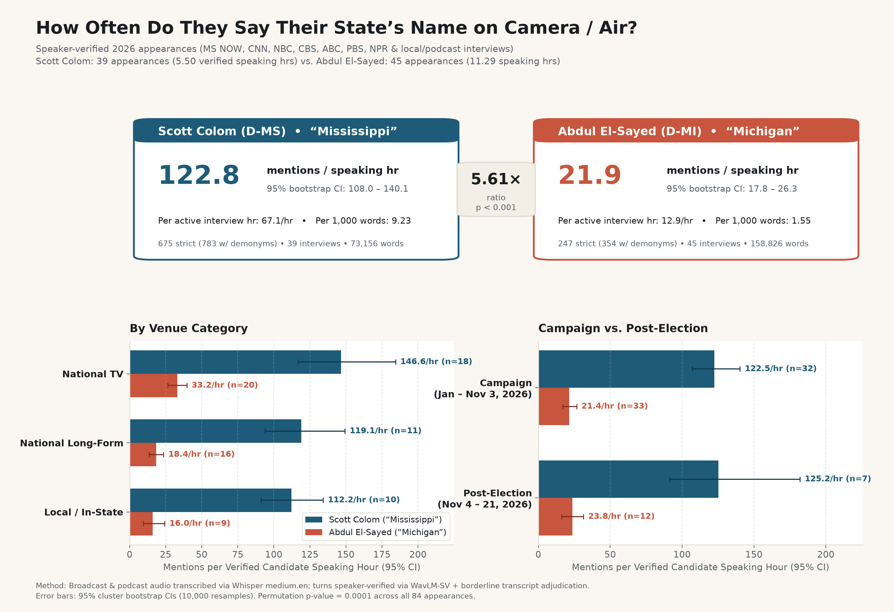
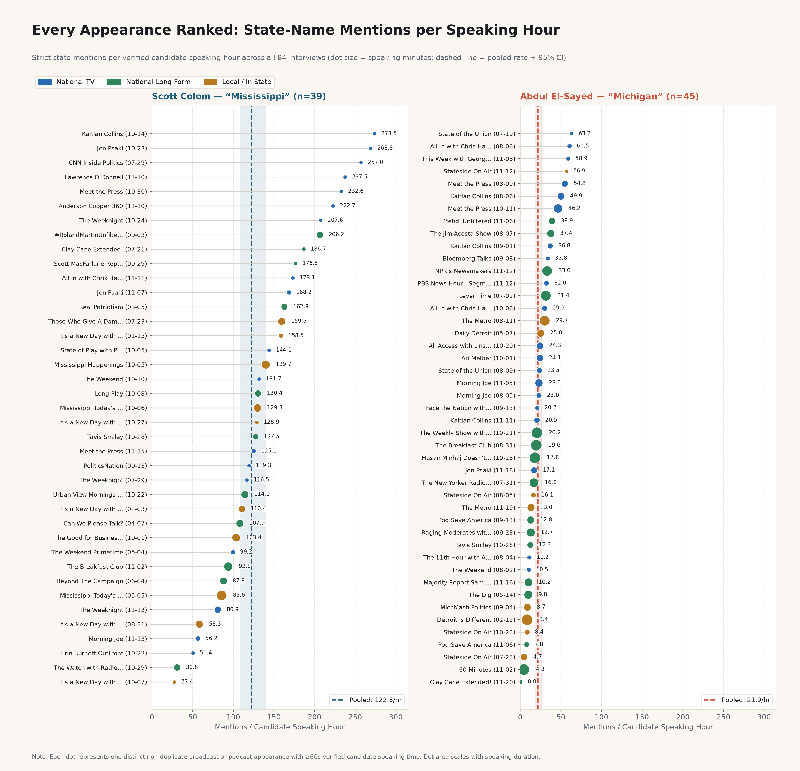
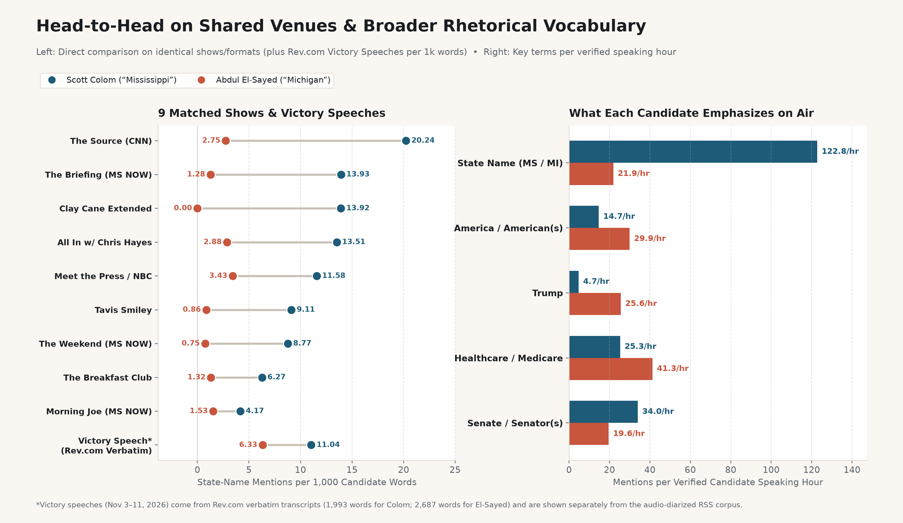
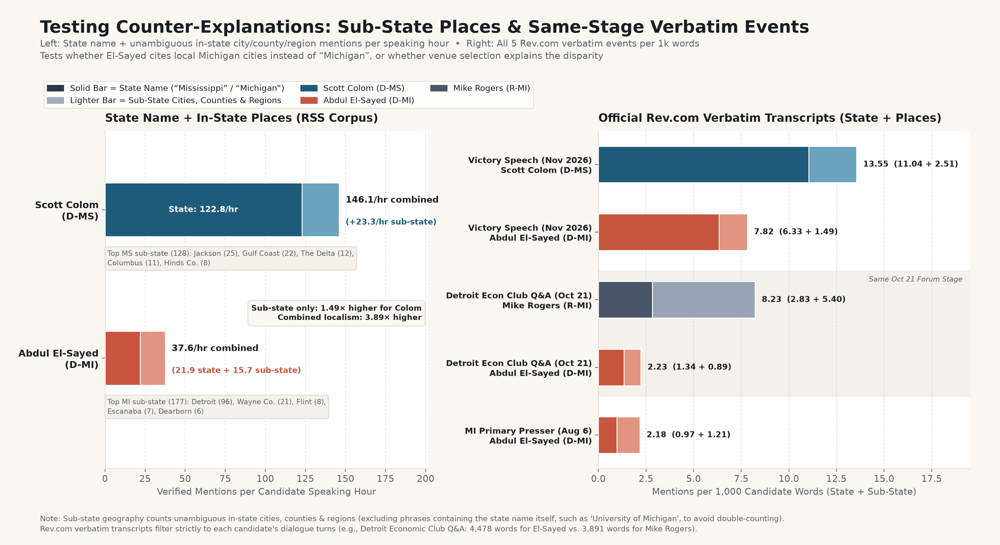

# State-Name Frequency Analysis: Scott Colom vs. Abdul El-Sayed

> ### **[Launch Interactive Evaluation Explorer -> `https://mike10010100.github.io/elections-2026/state-name-analysis/`](https://mike10010100.github.io/elections-2026/state-name-analysis/)**
>
> **Direct Dataset Downloads:** [`appearances_summary.csv`](dataset/appearances_summary.csv) · [`mentions_audit.csv`](dataset/mentions_audit.csv) · [`summary_stats.json`](dataset/summary_stats.json) · [`mention_adjudications.json`](dataset/mention_adjudications.json) · [`excluded_episodes.json`](dataset/excluded_episodes.json) · [`rss_corpus_manifest.json`](dataset/rss_corpus_manifest.json)
>
> **Reproducible Scripts:** [`scripts/`](scripts/) (7 pipeline & plotting scripts; 15 GB raw MP3/WAV audio and intermediate ASR dumps omitted to keep this repository lightweight, while every RSS audio URL and Rev.com transcript source is preserved in [`dataset/rss_corpus_manifest.json`](dataset/rss_corpus_manifest.json) and [`dataset/victory_speeches_rev.json`](dataset/victory_speeches_rev.json) / [`dataset/rev_extra_transcripts.json`](dataset/rev_extra_transcripts.json)).

---

**Expanded, Speaker-Verified Empirical Analysis (84 Interviews + 5 Official Rev.com Verbatim Transcripts)**

> **Short Answer:** Across **84 speaker-verified 2026 interviews** (**39** for Scott Colom, `5.50` verified speaking hours; **45** for Abdul El-Sayed, `11.29` verified speaking hours), **Scott Colom says “Mississippi” `122.8` times per speaking hour** (`675` mentions; 95% cluster bootstrap CI `[108.0, 140.1]`), while **Abdul El-Sayed says “Michigan” `21.9` times per speaking hour** (`247` mentions; 95% CI `[17.8, 26.3]`). Colom mentions his state **`5.61×` as often** per speaking hour (`p = 0.0001`), **`5.93×` as often** per 1,000 spoken words (`9.23` vs. `1.55`), and **`5.20×` as often** per active interview hour (`67.1/hr` vs. `12.9/hr`).

## 1. Headline Results & Statistical Summary

This analysis answers [Dana Houle’s question](https://bsky.app/profile/danahoule.bsky.social/post/3n2uo3feyf22w) using a fully speaker-verified corpus built from public broadcast television audio feeds (MS NOW, CNN, NBC, CBS, ABC, PBS), public radio/podcasts (NPR, Michigan Public *Stateside*, WDET *The Metro*, Mississippi Today, etc.), and verbatim Rev.com transcripts.

To prevent host questions, chyron/intro recaps, or pundit commentary from inflating either candidate’s count, every audio segment was transcribed with Whisper `medium.en` and speaker-attributed using calibrated `WavLM-SV` utterance embeddings — followed by a **complete manual transcript audit of all 165 acoustically borderline/disagreeing mentions** (`70` verified adjustments).

| Metric | Scott Colom (D-MS) | Abdul El-Sayed (D-MI) | Difference (95% CI) | Ratio (95% CI) | Perm. *p*-value |
|---|---:|---:|---:|---:|---:|
| **Appearances Included** | **39** | **45** | — | — | — |
| Verified Candidate Speaking Hours | `5.50 hrs` | `11.29 hrs` | — | — | — |
| Active Interview Window Hours | `10.06 hrs` | `19.15 hrs` | — | — | — |
| Verified Candidate Spoken Words | `73,156` | `158,826` | — | — | — |
| **Strict State Mentions (Adjudicated)** | **`675`** | **`247`** | — | — | — |
| **Rate / Verified Speaking Hour (Primary)** | **`122.78/hr`** `[108.0, 140.1]` | **`21.89/hr`** `[17.8, 26.3]` | `+100.90/hr` `[85.7, 118.8]` | **`5.61×`** `[4.48×, 7.16×]` | **`0.0001`** |
| Rate / Verified Speaking Hr (Raw Acoustic) | `118.24/hr` (`650`) | `20.64/hr` (`233`) | `+97.60/hr` | `5.73×` | — |
| Rate / Active Interview Hour | `67.11/hr` `[58.6, 76.5]` | `12.90/hr` `[10.4, 15.6]` | — | `5.20×` | — |
| **Rate / 1,000 Candidate Words** | **`9.23`** `[8.14, 10.47]` | **`1.55`** `[1.27, 1.87]` | `+7.67` `[6.54, 8.98]` | **`5.93×`** `[4.73×, 7.60×]` | **`0.0001`** |
| Broad Rate / Speaking Hr (incl. Demonyms) | `142.43/hr` (`783`) | `31.37/hr` (`354`) | — | `4.54×` | — |
| Episode-Level Median [IQR] / Speaking Hr | `129.35/hr` `[101.3–174.8]` | `20.73/hr` `[12.3–33.0]` | — | — | — |

## 2. Corpus Coverage & Expansion

The initial corpus (`74` interviews) was expanded to **84 verified candidate interviews** (`96` total manifest entries processed; `12` excluded) and **5 official Rev.com verbatim transcripts**:

- **10 new verified RSS candidate interviews added:** Scott Colom on *All In with Chris Hayes* (Nov 11) plus two earlier *It's a New Day with Rip Daniels* shows (Jan 15 & Feb 3); Abdul El-Sayed on *All In with Chris Hayes* (Aug 6 & Oct 6), *The Dig* (May 14), and four Michigan Public *Stateside On Air* appearances (Jul 23, Aug 5, Oct 23, Nov 12).

- **12 documented non-candidate / ambiguous exclusions ([`dataset/excluded_episodes.json`](dataset/excluded_episodes.json)):** 4 localized pundit-only segments (`colom_morningjoe_20261113_6/7`, `colom_weekend_20261010_7/9`), 4 commentary/panel/clip-only episodes where the candidate was never interviewed (`colom_freshair_20261119`, `abdul_morningjoe_20260810`, `abdul_macfarlane_20261019`, plus newly inspected Nov 12 post-election panels `colom_allin_20261112` and `colom_psaki_20261112`), 2 shows with `<60s` verified candidate speech (`colom_mtpnow_20261105`, `abdul_playbook_20261016`), and 1 joint interview with Scott Colom’s identical twin brother Andrew Colom (`colom_beat_20261121`), excluded so twin voice overlap cannot bias attribution.

- **5 Rev.com verbatim transcripts parsed (`rev_all_transcripts`):** Added the October 21 Detroit Economic Club Q&A (providing both Abdul El-Sayed and GOP nominee Mike Rogers on the same stage under the same moderator) and El-Sayed’s August 6 Michigan Primary Victory Press Conference alongside both November Election Night Victory Speeches.

## 3. Consistency Across Venue Types & Campaign Periods

The disparity is not an artifact of podcast length or post-election victory laps. It holds cleanly in National TV studios, long-form podcasts, local in-state media, pre-election campaigning, and post-election interviews:

| Stratum | Colom *n* | Colom Speaking Hrs | Colom Rate (95% CI) | El-Sayed *n* | El-Sayed Speaking Hrs | El-Sayed Rate (95% CI) | Ratio |
|---|---:|---:|---:|---:|---:|---:|---:|
| **National TV** | 18 | `1.27` | **`146.6/hr`** `[116.8, 184.4]` | 20 | `3.01` | **`33.2/hr`** `[26.5, 39.6]` | **`4.42×`** |
| **National Long-Form / Podcast** | 11 | `2.07` | **`119.1/hr`** `[93.9, 149.2]` | 16 | `6.03` | **`18.4/hr`** `[13.5, 23.5]` | **`6.47×`** |
| **Local / In-State Media** | 10 | `2.15` | **`112.2/hr`** `[91.0, 134.2]` | 9 | `2.24` | **`16.0/hr`** `[9.4, 24.2]` | **`6.99×`** |
| **Campaign (Jan – Nov 3, 2026)** | 32 | `4.84` | **`122.5/hr`** `[107.0, 140.3]` | 33 | `9.06` | **`21.4/hr`** `[16.9, 26.7]` | **`5.72×`** |
| **Post-Election (Nov 4 – 21, 2026)** | 7 | `0.66` | **`125.2/hr`** `[91.4, 182.0]` | 12 | `2.23` | **`23.8/hr`** `[16.3, 31.4]` | **`5.27×`** |

## 4. Head-to-Head on 9 Matched Shows & Broader Vocabulary

Restricting strictly to shows where **both** candidates sat for verified interviews yields **9 matched shared venues** (plus Rev.com Victory Speeches). Colom says his state’s name far more often per 1,000 words — and per speaking hour — in **all 9 out of 9 shared shows**.

| Shared Venue / Format | Colom *n* | Colom / 1k Words | Colom / Speaking Hr | El-Sayed *n* | El-Sayed / 1k Words | El-Sayed / Speaking Hr | Per-1k Ratio |
|---|---:|---:|---:|---:|---:|---:|---:|
| The Source (CNN) | 1 | `20.24` | `273.5/hr` | 3 | `2.75` | `37.8/hr` | **`7.37×`** |
| The Briefing (MS NOW) | 2 | `13.93` | `196.5/hr` | 1 | `1.28` | `17.1/hr` | **`10.91×`** |
| Clay Cane Extended | 1 | `13.92` | `186.7/hr` | 1 | `0.00` | `0.0/hr` | **`∞`** (`13.92` vs `0`) |
| All In w/ Chris Hayes | 1 | `13.51` | `173.1/hr` | 2 | `2.88` | `42.9/hr` | **`4.69×`** |
| Meet the Press / NBC | 3 | `11.58` | `164.6/hr` | 2 | `3.43` | `49.2/hr` | **`3.38×`** |
| Tavis Smiley | 1 | `9.11` | `127.5/hr` | 1 | `0.86` | `12.3/hr` | **`10.58×`** |
| The Weekend (MS NOW) | 2 | `8.77` | `112.3/hr` | 1 | `0.75` | `10.5/hr` | **`11.64×`** |
| The Breakfast Club | 1 | `6.27` | `93.8/hr` | 1 | `1.32` | `19.6/hr` | **`4.75×`** |
| Morning Joe (MS NOW) | 1 | `4.17` | `56.2/hr` | 2 | `1.53` | `23.0/hr` | **`2.73×`** |

### What Each Candidate Emphasizes Instead

| Lexical Term / Topic | Colom / Speaking Hr | Colom / 1k Words | El-Sayed / Speaking Hr | El-Sayed / 1k Words |
|---|---:|---:|---:|---:|
| **State Name (“Mississippi” / “Michigan”)** | `122.78/hr` | `9.23` | `21.89/hr` | `1.56` |
| Unambiguous Sub-State Geography (Cities/Counties/Regions) | `23.28/hr` | `1.75` | `15.68/hr` | `1.11` |
| America / American(s) | `14.73/hr` | `1.11` | `29.95/hr` | `2.13` |
| Trump | `4.73/hr` | `0.36` | `25.61/hr` | `1.82` |
| Healthcare / Medicare | `25.28/hr` | `1.90` | `41.29/hr` | `2.93` |
| Senate / Senator(s) | `34.02/hr` | `2.56` | `19.58/hr` | `1.39` |

Where Colom centers his rhetoric directly around `Mississippi` (`122.78/hr`, vs. `4.73/hr` for `Trump` and `14.73/hr` for `America`), El-Sayed distributes his framing across national healthcare policy (`41.29/hr`), `America / American(s)` (`29.95/hr`), and `Trump` (`25.61/hr`), mentioning `Michigan` (`21.89/hr`) less frequently than any of those three.

## 5. Counter-Explanation Tests: Sub-State Places & Same-Stage Verbatim Events

### Test A: Does El-Sayed Say “Detroit” or “Flint” Instead of “Michigan”?

No. Using a non-overlapping multi-word + unigram lexicon of unambiguous in-state cities, counties, and regions — and **strictly excluding phrases that contain the state name** (e.g., *University of Michigan*, *Mississippi Gulf Coast*) so nothing is double-counted — shows that **Scott Colom also cites sub-state places 1.49× as often as Abdul El-Sayed**:

| Geographic Measure | Scott Colom (D-MS) | Abdul El-Sayed (D-MI) | Difference (95% CI) | Ratio (95% CI) | Perm. *p*-value |
|---|---:|---:|---:|---:|---:|
| Sub-State Places Count (Unambiguous) | `128` | `177` | — | — | — |
| Sub-State Rate / Speaking Hr | `23.28/hr` `[18.5, 28.5]` | `15.68/hr` `[10.5, 21.3]` | `+7.60/hr` `[0.29, 14.92]` | **`1.49×`** `[1.01×, 2.31×]` | `0.0673` |
| Sub-State Rate / 1,000 Words | `1.75` | `1.11` | — | `1.57×` | — |
| **Combined Localism (State + Sub-State)** | **`803` (`146.07/hr`)** | **`424` (`37.57/hr`)** | `+108.50/hr` `[90.8, 128.7]` | **`3.89×`** `[3.16×, 4.91×]` | **`0.0001`** |

**Top Cited In-State Places (RSS Corpus):** A person-name guard in `count_substate_geo` prevented false-positive “Jackson” matches when preceded by first names like “Jesse Jackson” (while retaining Colom’s genuine Jackson, MS rally mention in `colom_morningjoe_20261113_8`), and `up north` (6 hits) + `wolverine` (3 U-M/state-mascot hits) were retained after verifying every utterance in context:

| Rank | Scott Colom — Top MS Places | Count | Abdul El-Sayed — Top MI Places | Count |
|---:|---|---:|---|---:|
| 1 | Jackson | 25 | Detroit | 96 |
| 2 | Gulf Coast | 22 | Wayne County | 21 |
| 3 | The Delta | 12 | Flint | 8 |
| 4 | Columbus | 11 | Escanaba | 7 |
| 5 | Hinds County | 8 | Dearborn | 6 |
| 6 | George County | 6 | Grand Rapids | 6 |
| 7 | Jackson State | 6 | Up North | 6 |
| 8 | Lowndes County | 5 | Lansing | 4 |
| 9 | Desoto County | 4 | Macomb County | 3 |
| 10 | Golden Triangle | 4 | Pontiac | 3 |
| 11 | Tupelo | 4 | Upper Peninsula | 3 |
| 12 | Greenwood | 3 | Wolverine | 3 |
| 13 | Clarksdale | 2 | Montcalm County | 2 |
| 14 | Hancock County | 2 | Oakland County | 2 |
| 15 | Mound Bayou | 2 | Houghton | 1 |

### Test B: Official Rev.com Verbatim Events (Including GOP Opponent Mike Rogers on the Same Stage)

Official verbatim Rev.com speaker transcripts eliminate Whisper ASR and speaker-attribution noise entirely — and the **October 21 Detroit Economic Club Q&A** provides a direct same-stage comparison against GOP nominee **Mike Rogers** answering the same moderator in front of the same Michigan business audience:

| Rev.com Verbatim Event | Speaker | Words | Strict State | State / 1k Words | Sub-State Places | Sub-State / 1k Words | Top Sub-State Places |
|---|---|---:|---:|---:|---:|---:|---|
| [Scott Colom Victory Speech (Nov 2026)](https://www.rev.com/blog/transcripts/scott-colom-victory-speech) | Scott Colom | `1,993` | `22` | **`11.04`** | `5` | `2.51` | George County (1), Hattiesburg (1), Jackson (1), Natchez (1), Oktibbeha County (1) |
| [Abdul El-Sayed Victory Speech (Nov 2026)](https://www.rev.com/blog/transcripts/abdul-el-sayed-victory-speech) | Abdul El-Sayed | `2,687` | `17` | **`6.33`** | `4` | `1.49` | Detroit (1), East Jordan (1), Pontiac (1), Wolverine (1) |
| [Detroit Economic Club Q&A — Mike Rogers (Oct 21)](https://www.rev.com/blog/transcripts/el-sayed-and-rogers-take-questions) | Mike Rogers | `3,891` | `11` | **`2.83`** | `21` | `5.40` | Detroit (15), Flint (2), Bay City (1), Grand Rapids (1), Pontiac (1), Saginaw (1) |
| [Detroit Economic Club Q&A — Abdul El-Sayed (Oct 21)](https://www.rev.com/blog/transcripts/el-sayed-and-rogers-take-questions) | Abdul El-Sayed | `4,478` | `6` | **`1.34`** | `4` | `0.89` | Detroit (2), Wayne County (2) |
| [MI Primary Victory Press Conf — Abdul El-Sayed (Aug 6)](https://www.rev.com/blog/transcripts/abdul-el-sayed-wins-michigan-senate-primary) | Abdul El-Sayed | `4,142` | `4` | **`0.97`** | `5` | `1.21` | Detroit (2), Escanaba (1), Grand Rapids (1), Lansing (1) |

Notice two critical checks: even in prepared victory speeches, Colom used his state’s name **`1.74×` as often per 1,000 words** (`11.04` vs. `6.33`, `22` vs. `17` mentions); and at the October 21 Detroit Economic Club Q&A, GOP opponent **Mike Rogers** said `Michigan` **`2.11×` as often** (`2.83` vs. `1.34` per 1k words) and cited Michigan cities **`6.07×` as often** (`5.40` vs. `0.89`, including `15` references to Detroit vs. El-Sayed’s `2`).

## 6. Methodology, Calibration & Borderline Adjudication Audit

### Audio Pipeline & Voiceprint Calibration

1. **Transcription:** All 84 eligible episodes were localized to the interview region (`faster-whisper` `medium.en` on GPU) with word-level timestamps (`3` prefix edge-case hits verified as benign domain strings: `michiganpublic`).

2. **Zero-Padding Fix & Clustering:** Flattened word streams were segmented into candidate utterances and embedded using `microsoft/wavlm-base-plus-sv` with **no batch zero-padding** (`embed_chunks_nopad`). Candidate centroids built from verified solo clips achieved clean separation (`cross-candidate similarity = 0.6260`). Calibrated cosine thresholds: `tau_colom = 0.945`, `tau_abdul = 0.915`.

3. **Naive Transcript Failure Proof:** Counting raw transcript occurrences without speaker diarization attributes **`45.3%`** of `"Mississippi"` mentions (`560/1235`) and **`62.4%`** of `"Michigan"` mentions (`410/657`) to hosts, panelists, and intros (`naive window rates: 47.43/hr vs. 20.90/hr`).

### Threshold Sensitivity & Raw-vs.-Adjudicated Audit

| Acoustic Threshold Setting | Colom Speak Hrs | Colom Strict (/hr) | El-Sayed Speak Hrs | El-Sayed Strict (/hr) | Ratio |
|---|---:|---:|---:|---:|---:|
| Loose (`tau - 0.025`, raw acoustic) | `7.11` | `758` (`106.58/hr`) | `13.01` | `276` (`21.21/hr`) | `5.02×` |
| Primary (`tau_colom=0.945, tau_abdul=0.915`, raw acoustic) | `5.50` | `650` (`118.24/hr`) | `11.29` | `233` (`20.64/hr`) | `5.73×` |
| Strict (`tau + 0.025`, raw acoustic) | `3.00` | `329` (`109.58/hr`) | `8.27` | `163` (`19.72/hr`) | `5.56×` |
| **Primary + Manual Borderline Adjudication (Headline)** | **`5.50`** | **`675` (`122.78/hr`)** | **`11.29`** | **`247` (`21.89/hr`)** | **`5.61×`** |

Every acoustically borderline/disagreeing mention (`165` total: **72** in-cluster `raw_cand=False` mentions with `sim_local >= tau`, plus **93** `raw_cand=True` mentions with `sim_local < tau`) was manually read with ±18 seconds of surrounding context ([`dataset/mention_adjudications.json`](dataset/mention_adjudications.json)):

- **Scott Colom:** `+34` strict (`+40` broad incl. demonyms) missed candidate turns restored (e.g., `colom_lastword_20261110` campaign-ad voiceover & `colom_mtp_20261115` short transition clauses); `-9` host/panel leaks removed (e.g., *It’s a New Day with Rip Daniels* host questions on Jan 15 & Aug 31, *Good for Business* host Mississippi State football question, `#RolandMartinUnfiltered` panelist reference to `Colom`). Net strict shift: `650 -> 675` (`+3.85%`; `118.24 -> 122.78/hr`).

- **Abdul El-Sayed:** `+16` strict (`+19` broad) missed candidate turns restored (e.g., *All In with Chris Hayes* “I've been an Abdul in Michigan my whole life” & *All Access* “I want a world, I want a Michigan”), `-2` host leaks removed (*The Beat with Ari Melber* `[406.27s]` gas-price host recap & *The Weekend* `[1007.80s]` primary-day host intro). Net strict shift: `233 -> 247` (`+6.01%`; `20.64 -> 21.89/hr`).

- **Stability conclusion:** Manual adjudication retains `82/93` (`88.2%`) of the `cand_loc_lt_tau` borderline subset as genuine candidate utterances and recovers `59/72` in-cluster misses, shifting the headline ratio only marginally from **`5.73×` (raw) to `5.61×` (adjudicated)**.

## 7. Limitations & Boundaries

- **Unavailable Video Archives:** C-SPAN / Internet Archive TV News MP4 & closed-caption files returned `HTTP 403 Forbidden`, YouTube audio extraction was excluded by rule, Rev.com’s Michigan Senate debate transcript returned `HTTP 404`, and `colom_wjtv_20260314` RSS audio returned `HTTP 404`. All findings represent publicly reachable RSS broadcast/podcast audio and verified Rev.com transcripts.

- **Simultaneous Twin / Clip Nuance:** Joint twin interview `colom_beat_20261121` was excluded to avoid Andrew/Scott voiceprint confounding; `colom_lastword_20261110` included a brief aired Scott Colom ad voiceover (“Every Mississippian ought to walk through once”) because Scott Colom himself spoke it.

- **Sub-State Place Names:** While “Jesse Jackson” was filtered via person-name context, `wolverine` includes 3 University of Michigan/mascot mentions in El-Sayed’s RSS interviews (`1.7%` of his 177 sub-state hits) and 1 in his victory speech; excluding those does not alter the sub-state conclusion.

## 8. Complete Per-Appearance Dataset (84 Verified Interviews)

| Episode ID | Candidate | Date | Show | Category | Period | Speak Min | Words | Raw Strict | Adj Strict | Broad | Non-Cand Filtered | Sub-State Geo | Strict / Hr | Strict / 1k |
|---|---|---:|---|---|---|---:|---:|---:|---:|---:|---:|---:|---:|---:|
| `colom_mtp_20261115` | `scott_colom` | 2026-11-15 | Meet the Press | `national_tv` | `post_election` | 6.2 | 1,473 | 11 | 13 | 14 | 4 | 0 | **125.1** | 8.83 |
| `colom_weeknight_20261113` | `scott_colom` | 2026-11-13 | The Weeknight | `national_tv` | `post_election` | 11.9 | 2,728 | 15 | 16 | 16 | 32 | 11 | **80.9** | 5.87 |
| `colom_morningjoe_20261113_8` | `scott_colom` | 2026-11-13 | Morning Joe | `national_tv` | `post_election` | 6.4 | 1,439 | 6 | 6 | 8 | 8 | 1 | **56.2** | 4.17 |
| `colom_allin_20261111` | `scott_colom` | 2026-11-11 | All In with Chris Hayes | `national_tv` | `post_election` | 4.2 | 888 | 12 | 12 | 16 | 10 | 2 | **173.1** | 13.51 |
| `colom_ac360_20261110` | `scott_colom` | 2026-11-10 | Anderson Cooper 360 | `national_tv` | `post_election` | 1.9 | 423 | 7 | 7 | 7 | 4 | 3 | **222.7** | 16.55 |
| `colom_lastword_20261110` | `scott_colom` | 2026-11-10 | The Last Word with Lawrence O’Donnell | `national_tv` | `post_election` | 3.0 | 641 | 9 | 12 | 14 | 14 | 3 | **237.5** | 18.72 |
| `colom_psaki_20261107` | `scott_colom` | 2026-11-07 | The Briefing with Jen Psaki | `national_tv` | `post_election` | 5.7 | 1,287 | 14 | 16 | 17 | 15 | 3 | **168.2** | 12.43 |
| `colom_breakfastclub_20261102` | `scott_colom` | 2026-11-02 | The Breakfast Club | `national_longform` | `campaign` | 19.8 | 4,944 | 30 | 31 | 35 | 13 | 7 | **93.8** | 6.27 |
| `colom_mtpnow_20261030` | `scott_colom` | 2026-10-30 | Meet the Press | `national_tv` | `campaign` | 4.4 | 1,075 | 17 | 17 | 18 | 4 | 2 | **232.6** | 15.81 |
| `colom_watch_20261029` | `scott_colom` | 2026-10-29 | The Watch with Radley Balko | `national_longform` | `campaign` | 11.7 | 2,806 | 5 | 6 | 6 | 23 | 0 | **30.8** | 2.14 |
| `colom_tavissmiley_20261028` | `scott_colom` | 2026-10-28 | Tavis Smiley | `national_longform` | `campaign` | 8.9 | 2,085 | 18 | 19 | 22 | 14 | 4 | **127.5** | 9.11 |
| `colom_ripdaniels_20261027` | `scott_colom` | 2026-10-27 | It's a New Day with Rip Daniels | `local_in_state` | `campaign` | 4.2 | 1,083 | 8 | 9 | 9 | 9 | 3 | **128.9** | 8.31 |
| `colom_weeknight_20261024` | `scott_colom` | 2026-10-24 | The Weeknight | `national_tv` | `campaign` | 2.9 | 757 | 9 | 10 | 11 | 15 | 2 | **207.6** | 13.21 |
| `colom_psaki_20261023` | `scott_colom` | 2026-10-23 | The Briefing with Jen Psaki | `national_tv` | `campaign` | 2.2 | 580 | 10 | 10 | 11 | 4 | 0 | **268.8** | 17.24 |
| `colom_outfront_20261022` | `scott_colom` | 2026-10-22 | Erin Burnett OutFront | `national_tv` | `campaign` | 2.4 | 553 | 2 | 2 | 8 | 2 | 0 | **50.4** | 3.62 |
| `colom_urbanview_20261022` | `scott_colom` | 2026-10-22 | Urban View Mornings Podcast | `national_longform` | `campaign` | 14.7 | 3,102 | 29 | 28 | 29 | 19 | 6 | **114.0** | 9.03 |
| `colom_collins_20261014` | `scott_colom` | 2026-10-14 | The Source with Kaitlan Collins | `national_tv` | `campaign` | 2.6 | 593 | 11 | 12 | 16 | 8 | 1 | **273.5** | 20.24 |
| `colom_weekend_20261010_8` | `scott_colom` | 2026-10-10 | The Weekend | `national_tv` | `campaign` | 4.1 | 953 | 9 | 9 | 17 | 9 | 0 | **131.7** | 9.44 |
| `colom_longplay_20261008` | `scott_colom` | 2026-10-08 | Long Play | `national_longform` | `campaign` | 11.5 | 2,617 | 25 | 25 | 30 | 30 | 2 | **130.4** | 9.55 |
| `colom_ripdaniels_20261007` | `scott_colom` | 2026-10-07 | It's a New Day with Rip Daniels | `local_in_state` | `campaign` | 2.2 | 486 | 1 | 1 | 1 | 13 | 2 | **27.4** | 2.06 |
| `colom_mstoday_20261006` | `scott_colom` | 2026-10-06 | The Other Side: Mississippi Today's Political Podcast | `local_in_state` | `campaign` | 16.2 | 3,807 | 35 | 35 | 38 | 4 | 4 | **129.3** | 9.19 |
| `colom_stateofplay_20261005` | `scott_colom` | 2026-10-05 | State of Play with Peter Alexander | `national_tv` | `campaign` | 2.5 | 562 | 6 | 6 | 13 | 6 | 1 | **144.1** | 10.68 |
| `colom_mshappenings_20261005` | `scott_colom` | 2026-10-05 | Mississippi Happenings | `local_in_state` | `campaign` | 18.5 | 4,005 | 42 | 43 | 49 | 21 | 5 | **139.7** | 10.74 |
| `colom_goodforbiz_20261001` | `scott_colom` | 2026-10-01 | The Good for Business Podcast with Eric & Colin Krieger | `local_in_state` | `campaign` | 16.8 | 3,664 | 30 | 29 | 33 | 18 | 10 | **103.4** | 7.91 |
| `colom_macfarlane_20260929` | `scott_colom` | 2026-09-29 | Scott MacFarlane Reports | `national_longform` | `campaign` | 3.4 | 826 | 8 | 10 | 11 | 11 | 2 | **176.5** | 12.11 |
| `colom_politicsnation_20260913` | `scott_colom` | 2026-09-13 | PoliticsNation | `national_tv` | `campaign` | 3.0 | 619 | 6 | 6 | 8 | 6 | 0 | **119.3** | 9.69 |
| `colom_roland_20260903` | `scott_colom` | 2026-09-03 | #RolandMartinUnfiltered | `national_longform` | `campaign` | 11.9 | 2,841 | 42 | 41 | 41 | 27 | 10 | **206.2** | 14.43 |
| `colom_ripdaniels_20260831` | `scott_colom` | 2026-08-31 | It's a New Day with Rip Daniels | `local_in_state` | `campaign` | 14.4 | 2,605 | 15 | 14 | 20 | 38 | 8 | **58.3** | 5.37 |
| `colom_weeknight_20260729` | `scott_colom` | 2026-07-29 | The Weeknight | `national_tv` | `campaign` | 3.1 | 679 | 6 | 6 | 10 | 13 | 1 | **116.5** | 8.84 |
| `colom_insidepol_20260729` | `scott_colom` | 2026-07-29 | CNN Inside Politics | `national_tv` | `campaign` | 4.0 | 859 | 15 | 17 | 18 | 5 | 3 | **257.0** | 19.79 |
| `colom_giveadamn_20260723` | `scott_colom` | 2026-07-23 | Those Who Give A Damn Podcast | `local_in_state` | `campaign` | 14.3 | 3,253 | 35 | 38 | 44 | 38 | 5 | **159.5** | 11.68 |
| `colom_claycane_20260721` | `scott_colom` | 2026-07-21 | Clay Cane Extended! | `national_longform` | `campaign` | 3.9 | 862 | 12 | 12 | 13 | 9 | 0 | **186.7** | 13.92 |
| `colom_beyondcampaign_20260604` | `scott_colom` | 2026-06-04 | Beyond The Campaign | `national_longform` | `campaign` | 13.0 | 2,858 | 19 | 19 | 20 | 10 | 2 | **87.8** | 6.65 |
| `colom_mstoday_20260505` | `scott_colom` | 2026-05-05 | The Other Side: Mississippi Today's Political Podcast | `local_in_state` | `campaign` | 25.2 | 5,349 | 32 | 36 | 42 | 6 | 9 | **85.6** | 6.73 |
| `colom_weekendpt_20260504` | `scott_colom` | 2026-05-04 | The Weekend Primetime | `national_tv` | `campaign` | 6.1 | 1,214 | 10 | 10 | 14 | 13 | 2 | **99.2** | 8.24 |
| `colom_canweplease_20260407` | `scott_colom` | 2026-04-07 | Can We Please Talk? | `national_longform` | `campaign` | 14.5 | 2,987 | 24 | 26 | 29 | 13 | 1 | **107.9** | 8.70 |
| `colom_realpatriotism_20260305` | `scott_colom` | 2026-03-05 | Real Patriotism | `national_longform` | `campaign` | 11.1 | 2,330 | 28 | 30 | 37 | 18 | 5 | **162.8** | 12.88 |
| `colom_ripdaniels_20260203` | `scott_colom` | 2026-02-03 | It's a New Day with Rip Daniels | `local_in_state` | `campaign` | 11.4 | 2,213 | 21 | 21 | 23 | 37 | 5 | **110.4** | 9.49 |
| `colom_ripdaniels_20260115` | `scott_colom` | 2026-01-15 | It's a New Day with Rip Daniels | `local_in_state` | `campaign` | 5.7 | 1,110 | 16 | 15 | 15 | 17 | 3 | **158.5** | 13.51 |
| `abdul_claycane_20261120` | `abdul_el_sayed` | 2026-11-20 | Clay Cane Extended! | `national_longform` | `post_election` | 6.0 | 1,328 | 0 | 0 | 2 | 0 | 2 | **0.0** | 0.00 |
| `abdul_metro_20261119` | `abdul_el_sayed` | 2026-11-19 | The Metro | `local_in_state` | `post_election` | 13.8 | 2,960 | 3 | 3 | 5 | 8 | 2 | **13.0** | 1.01 |
| `abdul_psaki_20261118` | `abdul_el_sayed` | 2026-11-18 | The Briefing with Jen Psaki | `national_tv` | `post_election` | 10.5 | 2,349 | 3 | 3 | 4 | 3 | 0 | **17.1** | 1.28 |
| `abdul_majority_20261116` | `abdul_el_sayed` | 2026-11-16 | The Majority Report with Sam Seder | `national_longform` | `post_election` | 17.7 | 3,888 | 3 | 3 | 3 | 4 | 0 | **10.2** | 0.77 |
| `abdul_pbs_20261112` | `abdul_el_sayed` | 2026-11-12 | PBS News Hour - Segments | `national_tv` | `post_election` | 7.5 | 1,734 | 4 | 4 | 5 | 4 | 0 | **32.0** | 2.31 |
| `abdul_newsmakers_20261112` | `abdul_el_sayed` | 2026-11-12 | NPR's Newsmakers | `national_longform` | `post_election` | 25.5 | 5,678 | 14 | 14 | 16 | 1 | 3 | **33.0** | 2.47 |
| `abdul_stateside_20261112` | `abdul_el_sayed` | 2026-11-12 | Stateside On Air | `local_in_state` | `post_election` | 3.2 | 749 | 3 | 3 | 3 | 19 | 0 | **56.9** | 4.01 |
| `abdul_collins_20261111` | `abdul_el_sayed` | 2026-11-11 | The Source with Kaitlan Collins | `national_tv` | `post_election` | 8.8 | 2,032 | 3 | 3 | 3 | 2 | 2 | **20.5** | 1.48 |
| `abdul_thisweek_20261108` | `abdul_el_sayed` | 2026-11-08 | This Week with George Stephanopoulos | `national_tv` | `post_election` | 5.1 | 1,229 | 5 | 5 | 8 | 5 | 0 | **58.9** | 4.07 |
| `abdul_psa_20261106` | `abdul_el_sayed` | 2026-11-06 | Pod Save America | `national_longform` | `post_election` | 7.6 | 1,728 | 1 | 1 | 1 | 6 | 0 | **7.8** | 0.58 |
| `abdul_mehdi_20261106` | `abdul_el_sayed` | 2026-11-06 | Mehdi Unfiltered | `national_longform` | `post_election` | 12.3 | 2,967 | 8 | 8 | 8 | 5 | 3 | **38.9** | 2.70 |
| `abdul_morningjoe_20261105` | `abdul_el_sayed` | 2026-11-05 | Morning Joe | `national_tv` | `post_election` | 15.7 | 4,053 | 5 | 6 | 8 | 8 | 2 | **23.0** | 1.48 |
| `abdul_60min_20261102` | `abdul_el_sayed` | 2026-11-02 | 60 Minutes | `national_longform` | `campaign` | 41.4 | 10,090 | 3 | 3 | 3 | 5 | 1 | **4.3** | 0.30 |
| `abdul_hasanminhaj_20261028` | `abdul_el_sayed` | 2026-10-28 | Hasan Minhaj Doesn't Know | `national_longform` | `campaign` | 33.6 | 7,572 | 9 | 10 | 13 | 6 | 5 | **17.8** | 1.32 |
| `abdul_tavissmiley_20261028` | `abdul_el_sayed` | 2026-10-28 | Tavis Smiley | `national_longform` | `campaign` | 9.8 | 2,324 | 2 | 2 | 2 | 5 | 17 | **12.3** | 0.86 |
| `abdul_stateside_20261023` | `abdul_el_sayed` | 2026-10-23 | Stateside On Air | `local_in_state` | `campaign` | 7.1 | 1,609 | 1 | 1 | 1 | 17 | 6 | **8.4** | 0.62 |
| `abdul_jonstewart_20261021` | `abdul_el_sayed` | 2026-10-21 | The Weekly Show with Jon Stewart | `national_longform` | `campaign` | 35.6 | 8,501 | 11 | 12 | 19 | 13 | 17 | **20.2** | 1.41 |
| `abdul_allaccess_20261020` | `abdul_el_sayed` | 2026-10-20 | All Access with Linsey Davis | `national_tv` | `campaign` | 12.4 | 2,975 | 4 | 5 | 9 | 5 | 3 | **24.3** | 1.68 |
| `abdul_mtp_20261011` | `abdul_el_sayed` | 2026-10-11 | Meet the Press | `national_tv` | `campaign` | 20.8 | 5,129 | 15 | 16 | 21 | 5 | 4 | **46.2** | 3.12 |
| `abdul_allin_20261006` | `abdul_el_sayed` | 2026-10-06 | All In with Chris Hayes | `national_tv` | `campaign` | 8.0 | 2,007 | 2 | 4 | 6 | 12 | 0 | **29.9** | 1.99 |
| `abdul_beat_20261001` | `abdul_el_sayed` | 2026-10-01 | The Beat with Ari Melber | `national_tv` | `campaign` | 12.4 | 2,977 | 6 | 5 | 8 | 14 | 0 | **24.1** | 1.68 |
| `abdul_ragingmod_20260923` | `abdul_el_sayed` | 2026-09-23 | Raging Moderates with Scott Galloway and Jessica Tarlov | `national_longform` | `campaign` | 18.9 | 4,206 | 4 | 4 | 6 | 9 | 1 | **12.7** | 0.95 |
| `abdul_facethenation_20260913` | `abdul_el_sayed` | 2026-09-13 | Face the Nation with Margaret Brennan | `national_tv` | `campaign` | 5.8 | 1,461 | 1 | 2 | 2 | 6 | 1 | **20.7** | 1.37 |
| `abdul_psa_20260913` | `abdul_el_sayed` | 2026-09-13 | Pod Save America | `national_longform` | `campaign` | 14.1 | 3,214 | 2 | 3 | 5 | 26 | 4 | **12.8** | 0.93 |
| `abdul_bloomberg_20260908` | `abdul_el_sayed` | 2026-09-08 | Bloomberg Talks | `national_tv` | `campaign` | 5.3 | 1,234 | 3 | 3 | 6 | 6 | 0 | **33.8** | 2.43 |
| `abdul_michmash_20260904` | `abdul_el_sayed` | 2026-09-04 | MichMash Politics | `local_in_state` | `campaign` | 13.8 | 3,315 | 2 | 2 | 14 | 6 | 2 | **8.7** | 0.60 |
| `abdul_collins_20260901` | `abdul_el_sayed` | 2026-09-01 | The Source with Kaitlan Collins | `national_tv` | `campaign` | 8.2 | 1,836 | 5 | 5 | 9 | 10 | 0 | **36.8** | 2.72 |
| `abdul_breakfastclub_20260831` | `abdul_el_sayed` | 2026-08-31 | The Breakfast Club | `national_longform` | `campaign` | 58.1 | 14,408 | 16 | 19 | 21 | 10 | 22 | **19.6** | 1.32 |
| `abdul_metro_20260811` | `abdul_el_sayed` | 2026-08-11 | The Metro | `local_in_state` | `campaign` | 26.2 | 5,965 | 12 | 13 | 24 | 16 | 10 | **29.7** | 2.18 |
| `abdul_mtp_20260809` | `abdul_el_sayed` | 2026-08-09 | Meet the Press | `national_tv` | `campaign` | 11.0 | 2,459 | 10 | 10 | 12 | 25 | 3 | **54.8** | 4.07 |
| `abdul_sotu_20260809` | `abdul_el_sayed` | 2026-08-09 | State of the Union | `national_tv` | `campaign` | 7.6 | 1,800 | 3 | 3 | 4 | 12 | 0 | **23.5** | 1.67 |
| `abdul_jimacosta_20260807` | `abdul_el_sayed` | 2026-08-07 | The Jim Acosta Show | `national_longform` | `campaign` | 14.4 | 3,344 | 8 | 9 | 10 | 12 | 0 | **37.4** | 2.69 |
| `abdul_collins_20260806` | `abdul_el_sayed` | 2026-08-06 | The Source with Kaitlan Collins | `national_tv` | `campaign` | 13.2 | 3,050 | 10 | 11 | 16 | 7 | 1 | **49.9** | 3.61 |
| `abdul_allin_20260806` | `abdul_el_sayed` | 2026-08-06 | All In with Chris Hayes | `national_tv` | `campaign` | 6.0 | 1,466 | 5 | 6 | 10 | 15 | 1 | **60.5** | 4.09 |
| `abdul_morningjoe_20260805` | `abdul_el_sayed` | 2026-08-05 | Morning Joe | `national_tv` | `campaign` | 7.8 | 1,833 | 3 | 3 | 3 | 20 | 4 | **23.0** | 1.64 |
| `abdul_stateside_20260805` | `abdul_el_sayed` | 2026-08-05 | Stateside On Air | `local_in_state` | `campaign` | 7.5 | 1,745 | 2 | 2 | 2 | 4 | 0 | **16.1** | 1.15 |
| `abdul_11thhour_20260804` | `abdul_el_sayed` | 2026-08-04 | The 11th Hour with Ali Velshi | `national_tv` | `campaign` | 5.4 | 1,243 | 1 | 1 | 5 | 8 | 7 | **11.2** | 0.80 |
| `abdul_weekend_20260802` | `abdul_el_sayed` | 2026-08-02 | The Weekend | `national_tv` | `campaign` | 5.7 | 1,328 | 2 | 1 | 5 | 11 | 1 | **10.5** | 0.75 |
| `abdul_newyorker_20260731` | `abdul_el_sayed` | 2026-07-31 | The New Yorker Radio Hour | `national_longform` | `campaign` | 21.4 | 4,917 | 6 | 6 | 6 | 12 | 1 | **16.8** | 1.22 |
| `abdul_stateside_20260723` | `abdul_el_sayed` | 2026-07-23 | Stateside On Air | `local_in_state` | `campaign` | 12.9 | 3,094 | 1 | 1 | 1 | 15 | 2 | **4.7** | 0.32 |
| `abdul_sotu_20260719` | `abdul_el_sayed` | 2026-07-19 | State of the Union | `national_tv` | `campaign` | 3.8 | 936 | 4 | 4 | 8 | 11 | 0 | **63.2** | 4.27 |
| `abdul_levertime_20260702` | `abdul_el_sayed` | 2026-07-02 | Lever Time | `national_longform` | `campaign` | 26.8 | 6,231 | 14 | 14 | 19 | 14 | 8 | **31.4** | 2.25 |
| `abdul_thedig_20260514` | `abdul_el_sayed` | 2026-05-14 | The Dig | `national_longform` | `campaign` | 18.4 | 3,814 | 3 | 3 | 5 | 2 | 6 | **9.8** | 0.79 |
| `abdul_dailydetroit_20260507` | `abdul_el_sayed` | 2026-05-07 | Daily Detroit | `local_in_state` | `campaign` | 14.4 | 3,317 | 6 | 6 | 8 | 4 | 20 | **25.0** | 1.81 |
| `abdul_detroitdiff_20260212` | `abdul_el_sayed` | 2026-02-12 | Detroit is Different | `local_in_state` | `campaign` | 35.7 | 8,731 | 5 | 5 | 5 | 2 | 16 | **8.4** | 0.57 |

### Excluded Manifest Entries (12 Non-Candidate / Ambiguous / Sub-60s Shows)

| Episode ID | Candidate | Date | Show | Duration (s) | Exclusion Reason |
|---|---|---:|---|---:|---|
| `colom_freshair_20261119` | `scott_colom` | 2026-11-19 | Fresh Air | 2714 | `no_candidate_interview_guest_panel_only` |
| `colom_morningjoe_20261113_6` | `scott_colom` | 2026-11-13 | Morning Joe | — | `pundit_only_no_interview` |
| `colom_morningjoe_20261113_7` | `scott_colom` | 2026-11-13 | Morning Joe | — | `pundit_only_no_interview` |
| `colom_weekend_20261010_7` | `scott_colom` | 2026-10-10 | The Weekend | — | `pundit_only_no_interview` |
| `colom_weekend_20261010_9` | `scott_colom` | 2026-10-10 | The Weekend | — | `pundit_only_no_interview` |
| `colom_mtpnow_20261105` | `scott_colom` | 2026-11-05 | Meet the Press | 2991 | `verified_candidate_speech_under_60s` |
| `abdul_playbook_20261016` | `abdul_el_sayed` | 2026-10-16 | The Playbook Podcast | 1342 | `verified_candidate_speech_under_60s` |
| `colom_beat_20261121` | `scott_colom` | 2026-11-21 | The Beat with Ari Melber | 2499 | `joint_identical_twin_interview_andrew_colom` |
| `abdul_morningjoe_20260810` | `abdul_el_sayed` | 2026-08-10 | Morning Joe | 2751 | `no_candidate_interview_mike_rogers_and_panel` |
| `abdul_macfarlane_20261019` | `abdul_el_sayed` | 2026-10-19 | Scott MacFarlane Reports | 644 | `no_candidate_interview_commentary_and_clips_only` |
| `colom_allin_20261112` | `scott_colom` | 2026-11-12 | All In with Chris Hayes | 2943 | `no_candidate_interview_victory_clip_and_rally_panel` |
| `colom_psaki_20261112` | `scott_colom` | 2026-11-12 | The Briefing with Jen Psaki | 2508 | `no_candidate_interview_warnock_and_reporter_panel` |
