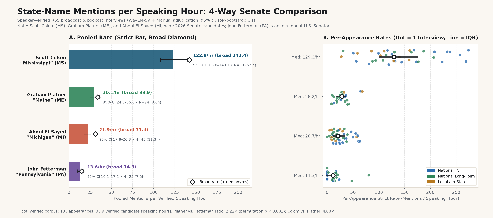
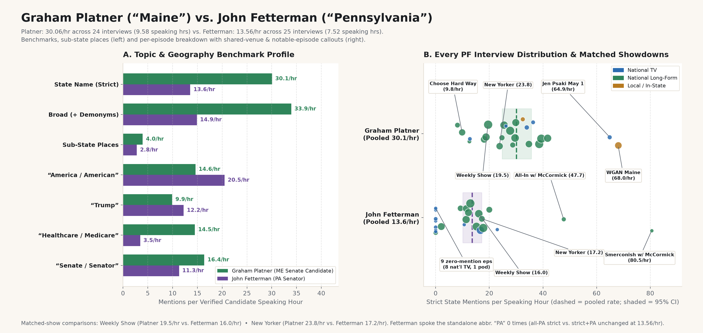

# State-Name Frequency Analysis: Graham Platner (“Maine”) vs. John Fetterman (“Pennsylvania”)

> **GitHub Repository Directory:** [`state-name-analysis/platner-fetterman/`](https://github.com/mike10010100/elections-2026/tree/main/state-name-analysis/platner-fetterman)  
> **Companion Study:** [`state-name-analysis/`](https://github.com/mike10010100/elections-2026/tree/main/state-name-analysis) (*Scott Colom vs. Abdul El-Sayed*)
>
> **Direct Dataset Downloads:** [`appearances_summary_pf.csv`](dataset/appearances_summary_pf.csv) · [`appearances_summary_pf.json`](dataset/appearances_summary_pf.json) · [`mentions_audit_pf.csv`](dataset/mentions_audit_pf.csv) · [`summary_stats_pf.json`](dataset/summary_stats_pf.json) · [`mention_adjudications.json`](dataset/mention_adjudications.json) · [`excluded_episodes.json`](dataset/excluded_episodes.json) · [`rss_manifest_pf.json`](dataset/rss_manifest_pf.json) · [`voiceprint_calibration.json`](dataset/voiceprint_calibration.json)
>
> **Reproducible Scripts:** [`scripts/`](scripts/) (raw audio WAVs/MP3s and full Whisper transcripts omitted to keep the repository lightweight; all public RSS enclosure URLs and timestamps are preserved in [`dataset/rss_manifest_pf.json`](dataset/rss_manifest_pf.json)).

---

> **Short Answer:** Across **49 speaker-verified broadcast & podcast interviews** (**24** for Graham Platner, `9.58` verified speaking hours; **25** for John Fetterman, `7.52` verified speaking hours), **Platner says “Maine” `30.06` times per speaking hour** (`288` mentions; 95% cluster-bootstrap CI `[24.79, 35.64]`), while **Fetterman says “Pennsylvania” `13.56` times per speaking hour** (`102` mentions; 95% CI `[10.06, 17.20]`). Platner mentions his state **`2.22×` as often** per speaking hour (`p = 0.0001`), **`1.98×` as often** per 1,000 spoken words (`2.55` vs. `1.29`, `p = 0.0001`), and **`2.28×` as often** under the broad state+demonym definition (`33.93/hr` vs. `14.89/hr`, `p = 0.0001`).  
> In the **4-way corpus (`N = 133` interviews, `33.89` speaking hours)**, **Scott Colom (“Mississippi”, `122.78/hr`)** still sits **`4.08×` above Platner (`30.06/hr`)**, followed by **Abdul El-Sayed (“Michigan”, `21.89/hr`)**, with **John Fetterman (`13.56/hr`)** lowest.

## 1. Headline Results & Role Context

This follow-up answers [a reply request on Bluesky](https://bsky.app/profile/govtsnark.bsky.social/post/3n2x76adggc2a) using the same speaker-verified RSS audio pipeline built for the Colom vs. El-Sayed study, upgraded with cohort-centered voice embeddings and exhaustive homophone auditing.

> **Important Role Context (2026 Senate Candidates vs. Sitting U.S. Senator):**  
> Scott Colom (MS), Graham Platner (ME), and Abdul El-Sayed (MI) were **2026 Senate candidates** introducing a state-based pitch, whereas John Fetterman (PA) is an **incumbent U.S. Senator** frequently booked on national TV about Senate shutdowns, foreign policy, and President Trump. That institutional mix shows directly in the data: **8 of Fetterman’s 11 national TV spots** had **0** “Pennsylvania” mentions (`7.94/hr` pooled national TV rate; median `0.00/hr`), while his two highest-rate appearances by far were joint bipartisan Pennsylvania-Senate pods alongside GOP Sen. Dave McCormick (*The Smerconish Podcast* `80.52/hr` and *All-In Podcast* `47.72/hr`, together supplying 17 of his 102 strict mentions in 17.3 speaking minutes). Even within national long-form podcasts alone (`14` shows), however, Fetterman (`14.97/hr`) trails Platner (`27.32/hr`, `17` shows) and El-Sayed (`18.4/hr`).

| Metric | Graham Platner (D-ME Candidate) | John Fetterman (D-PA Senator) | Difference (95% CI) | Ratio (95% CI) | Perm. *p*-value |
|---|---:|---:|---:|---:|---:|
| **Verified Interviews Included** | **24** (`2025-09-09`–`2026-06-10`) | **25** (`2025-02-21`–`2026-08-07`) | — | — | — |
| Verified Speaking Hours | `9.58 hrs` | `7.52 hrs` | — | — | — |
| Active Interview Window Hours | `16.48 hrs` | `13.03 hrs` | — | — | — |
| Verified Spoken Words | `112,795` | `79,165` | — | — | — |
| **Strict State Mentions (Adjudicated)** | **`288`** | **`102`** | — | — | — |
| Filtered Non-Candidate Mentions | `197` (`40.6%` of 485 window hits) | `85` (`45.5%` of 187 window hits) | — | — | — |
| **Rate / Verified Speaking Hour (Primary)** | **`30.06/hr`** `[24.79, 35.64]` | **`13.56/hr`** `[10.06, 17.20]` | `+16.50/hr` `[10.02, 22.93]` | **`2.22×`** `[1.63×, 3.06×]` | **`0.0001`** |
| Rate / Verified Speaking Hr (Raw Acoustic) | `27.45/hr` (`263`) | `13.03/hr` (`98`) | `+14.42/hr` | `2.11×` | — |
| Rate / Active Interview Hour | `17.48/hr` `[14.26, 21.01]` | `7.83/hr` `[5.67, 10.00]` | `+9.66/hr` | `2.23×` | — |
| **Rate / 1,000 Candidate Words** | **`2.55`** `[2.12, 3.02]` | **`1.29`** `[0.96, 1.65]` | `+1.27` `[0.70, 1.84]` | **`1.98×`** `[1.45×, 2.78×]` | **`0.0001`** |
| Broad Rate / Speaking Hr (+ Demonyms) | `33.93/hr` (`325`) `[28.33, 39.88]` | `14.89/hr` (`112`) `[11.17, 18.76]` | `+19.04/hr` `[12.21, 26.02]` | **`2.28×`** `[1.69×, 3.14×]` | **`0.0001`** |
| Strict + Standalone `“PA”` Abbreviation | — | `13.56/hr` (`102`, `0` candidate `PA` hits) | — | — | — |
| Episode Median [IQR] / Speaking Hr | `28.24/hr` `[19.29–35.09]` | `11.32/hr` `[0.00–16.63]` | — | — | — |

## 2. 4-Way Senate Corpus Comparison (`N = 133` Interviews)

| Candidate / Senator | State (Word) | Role | *N* | Speaking Hrs | Strict Rate / Hr (95% CI) | Broad Rate / Hr | Per 1k Words | Sub-State Places / Hr | Combined Local / Hr | Ep. Median [IQR] |
|---|---|---|---:|---:|---:|---:|---:|---:|---:|---:|
| **Scott Colom** | Mississippi (`MS`) | 2026 Candidate | 39 | `5.50h` | **`122.78`** `[108.04, 140.13]` | `142.43` | `9.23` | `23.28` | `146.07` | `129.35` `[101.29–174.82]` |
| **Graham Platner** | Maine (`ME`) | 2026 Candidate | 24 | `9.58h` | **`30.06`** `[24.79, 35.64]` | `33.93` | `2.55` | `3.97` | `34.03` | `28.24` `[19.29–35.09]` |
| **Abdul El-Sayed** | Michigan (`MI`) | 2026 Candidate | 45 | `11.29h` | **`21.89`** `[17.80, 26.26]` | `31.37` | `1.56` | `15.68` | `37.57` | `20.73` `[12.30–33.01]` |
| **John Fetterman** | Pennsylvania (`PA`) | Incumbent Senator | 25 | `7.52h` | **`13.56`** `[10.06, 17.20]` | `14.89` | `1.29` | `2.79` | `16.35` | `11.32` `[0.00–16.63]` |

Three nuances stand out in the 4-way view:
1. **Strict vs. Broad + Sub-State:** Platner outpaces El-Sayed on strict state mentions (`30.06/hr` vs. `21.89/hr`), largely because El-Sayed frequently uses **`“Michiganders”`** (`31.37/hr` broad vs. Platner `33.93/hr` broad) and sub-state Michigan places (`15.68/hr` for Detroit/Flint/Dearborn vs. Platner `3.97/hr` for Sullivan/Bangor/Portland/etc.), putting El-Sayed slightly ahead on combined state + sub-state geographic references (`37.57/hr` vs. `34.03/hr`).
2. **Colom Is in Another Stratosphere:** Even against Platner, who came in second at `30.06/hr`, Scott Colom’s `122.78/hr` is **`4.08×` higher**.
3. **Fetterman’s National-TV Zeroes:** Across `25` appearances, Fetterman had `9` zero-mention interviews (`8` national TV, `1` podcast); Platner had `0` zero-mention interviews (lowest: *The David Pakman Show* at `8.13/hr`).

## 3. Matched Shows, Venue Strata & Benchmark Topics

### Venue Strata (Platner vs. Fetterman)
| Venue Category | Platner *n* | Platner Hrs | Platner Rate (95% CI) | Fetterman *n* | Fetterman Hrs | Fetterman Rate (95% CI) |
|---|---:|---:|---:|---:|---:|---:|
| **National TV** | 5 | `0.79h` | **`36.67/hr`** `[21.59, 53.71]` | 11 | `1.51h` | **`7.94/hr`** `[0.00, 13.11]` (med `0.00`) |
| **National Long-Form / Podcast** | 17 | `8.16h` | **`27.32/hr`** `[22.49, 31.71]` | 14 | `6.01h` | **`14.97/hr`** `[11.25, 19.81]` |
| **Local / In-State Media** | 2 | `0.63h` | **`57.51/hr`** `[32.44, 68.02]` | 0 | `—` | `—` |

### Matched-Show Overlaps (Same Program, Verified Candidate Speech Only)
| Program | Scott Colom (MS) | Graham Platner (ME) | Abdul El-Sayed (MI) | John Fetterman (PA) |
|---|---:|---:|---:|---:|
| ***The Weekly Show w/ Jon Stewart*** | — | **`19.49/hr`** (`13` / `40.0m`) | — | **`16.04/hr`** (`9` / `33.7m`) |
| ***The New Yorker Radio Hour*** | — | **`23.76/hr`** (`10` / `25.3m`) | — | **`17.17/hr`** (`6` / `20.9m`) |
| ***The Briefing* (MS NOW)** | `196.51/hr` (`n=2`) | `40.87/hr` (`n=2`) | `17.10/hr` (`n=1`) | — |
| ***All In w/ Chris Hayes* (MS NOW)** | `173.10/hr` (`n=1`) | `31.82/hr` (`n=2`) | `42.90/hr` (`n=2`) | — |
| ***Morning Joe* (MS NOW)** | `56.25/hr` (`n=1`) | `36.26/hr` (`n=1`) | `23.00/hr` (`n=2`) | — |
| ***Meet the Press* (NBC)** | `164.64/hr` (`n=3`) | — | `49.20/hr` (`n=2`) | `5.18/hr` (`n=4`, med `0.00`) |
| ***State of the Union* (CNN)** | — | — | `36.70/hr` (`n=2`) | `0.00/hr` (`n=2`) |

### Benchmark Topics & Sub-State Geography (Mentions / Speaking Hour)
| Lexicon / Geography Benchmark | Graham Platner | John Fetterman | Notes |
|---|---:|---:|---|
| **State Name (Strict)** | **`30.06/hr`** | **`13.56/hr`** | `2.22×` (`p = 0.0001`) |
| Broad (+ Demonyms: *Mainer(s)* / *Pennsylvanian(s)*) | **`33.93/hr`** | **`14.89/hr`** | `2.28×` (`p = 0.0001`) |
| Sub-State Cities / Counties / Regions | **`3.97/hr`** (`38`) | **`2.79/hr`** (`21`) | `1.42×` (`p = 0.3338`, n.s.) |
| Combined State + Sub-State Geography | **`34.03/hr`** (`326`) | **`16.35/hr`** (`123`) | `2.08×` (`p = 0.0002`) |
| `“America / American(s)”` | `14.61/hr` | **`20.47/hr`** | Fetterman mentions America `1.51×` as often as Pennsylvania |
| `“Trump”` | `9.92/hr` | **`12.23/hr`** | — |
| `“Healthcare / Medicare”` | **`14.51/hr`** | `3.46/hr` | — |
| `“Senate / Senator”` | **`16.39/hr`** | `11.30/hr` | — |

Top verified sub-state mentions: **Platner** — Sullivan (`16`), Bangor (`4`), Hancock County (`4`), Portland (`4`), Lewiston (`3`), Ellsworth (`2`), Hancock (`2`), Bar Harbor (`1`), Downeast (`1`), Penobscot (`1`); **Fetterman** — Pittsburgh (`11`), Philadelphia (`3`), Braddock (`2`), Lancaster (`2`), Berks County (`1`), Lehigh Valley (`1`), York County (`1`).

## 4. Speaker Verification, Homophone Guards & Corpus Hygiene

1. **8-Speaker Cohort-Centered WavLM-SV + Resemblyzer GE2E ([`voiceprint_calibration.json`](dataset/voiceprint_calibration.json)):** Raw `microsoft/wavlm-base-plus-sv` embeddings exhibit strong male-baritone anisotropy between Platner and Fetterman (`0.9647` raw cosine similarity). Subtracting an 8-speaker background cohort mean $\mu_{\text{bg}}$ (Colom, El-Sayed, Chris Hayes, David Sirota, Jon Stewart, Nick Gillespie, David Friedberg, and ad voice) and L2-normalizing drops cross-candidate similarity to `0.7910` and delivers `+0.29` to `+0.40` cosine separation against interviewers. Dual-model mention verification paired cohort-centered WavLM (`tau_cen = 0.68` Platner, `0.72` Fetterman) with Resemblyzer (`tau_res = 0.77` Platner, `0.79` Fetterman).
2. **Threshold Sensitivity (Pre-Adjudication Acoustic Attribution):**
   - Low (`tau_cen - 0.04`): Platner `27.24/hr` | Fetterman `12.45/hr` (`2.19×`)
   - Mid (`0.68` / `0.72` centered): Platner `27.45/hr` | Fetterman `13.03/hr` (`2.11×`)
   - High (`tau_cen + 0.04`): Platner `27.42/hr` | Fetterman `12.15/hr` (`2.26×`)
3. **Homophone, Teaser & Abbreviation Audits ([`mention_adjudications.json`](dataset/mention_adjudications.json)):** All `256` acoustically borderline lines, `49` `"main"` / `"manor"` / `"manner"` ASR homophone candidates, `"PA"` standalone hits, and within-episode teaser repeats were manually audited (`46` verified adjudications):
   - Promoted **`7` Whisper homophones** of `Maine` / `Mainer(s)` (`4` strict `"main"` -> `"Maine"`, e.g. `"Sullivan main"`, `"our main oysters"`, `"main is tiny"`, `"the main wire"`; `3` broad `"manner"`/`"manor"`/`"manors"` -> `"Mainer(s)"`), while excluding false `"main point"` / `"main reason"` tokens.
   - Excluded **`3` Katie Couric cold-open teaser clips** replaying body-interview answers inside the intro bumper so mentions are never double-counted.
   - Audited standalone **`"PA"`**: Fetterman spoke **`0`** standalone `"PA"` tokens (`1` non-candidate PAC hit `"Common Ground PA"`), leaving strict and strict+PA rates identical (`13.56/hr`).
4. **3 Documented Episode Exclusions ([`excluded_episodes.json`](dataset/excluded_episodes.json)):** Out of `52` curated manifest entries, `gp_beacon_20251212` failed download (`HTTP 520`), `gp_11th_hour_velshi_20260605` was excluded as a `5`-gram syndication duplicate of `gp_all_in_hayes_20260605` (`jaccard = 0.652`, `containment = 0.812`), and `jf_collins_20250930` was excluded with `< 60s` verified candidate speech (`panel/highlight` episode), leaving `49` verified direct interviews.

## 5. Files Inventory

| Path | Description |
|---|---|
| [`dataset/summary_stats_pf.json`](dataset/summary_stats_pf.json) | Complete aggregate stats, 10,000-resample cluster bootstrap 95% CIs, permutation p-values, benchmarks, matched venues, and 4-way table |
| [`dataset/appearances_summary_pf.csv`](dataset/appearances_summary_pf.csv) | Episode-level summary table (`49` verified interviews) with speaking hours, mention counts, strict/broad/substate rates, and benchmarks |
| [`dataset/appearances_summary_pf.json`](dataset/appearances_summary_pf.json) | JSON version of episode-level summary |
| [`dataset/mentions_audit_pf.csv`](dataset/mentions_audit_pf.csv) | Every timestamped `"Maine"` / `"Pennsylvania"` / demonyn / `"PA"` / sub-state / homophone match with acoustic scores & attribution flags |
| [`dataset/mention_adjudications.json`](dataset/mention_adjudications.json) | All `46` manual adjudication overrides (borderline flips, host FPs, cold-open teaser exclusions, and homophone promotions) |
| [`dataset/excluded_episodes.json`](dataset/excluded_episodes.json) | Exact reasons and metadata for the `3` excluded manifest entries |
| [`dataset/rss_manifest_pf.json`](dataset/rss_manifest_pf.json) | Curated 52-entry RSS manifest with episode URLs, dates, categories, and HTTP probe results |
| [`dataset/voiceprint_calibration.json`](dataset/voiceprint_calibration.json) | 8-speaker cohort centering calibration diagnostics and slice timestamps |
| [`charts/chart_4way_colom_platner_fetterman_elsayed.png`](charts/chart_4way_colom_platner_fetterman_elsayed.png) | 4-way Senate state-name comparison chart (Colom, Platner, El-Sayed, Fetterman) |
| [`charts/chart_pf_appearances_ranked.png`](charts/chart_pf_appearances_ranked.png) | Platner vs. Fetterman topic benchmark profile and per-appearance distribution chart |
| [`scripts/`](scripts/) | End-to-end discovery, manifest curation, cohort-centered voiceprint calibration, Whisper transcription, attribution, and charting scripts |
